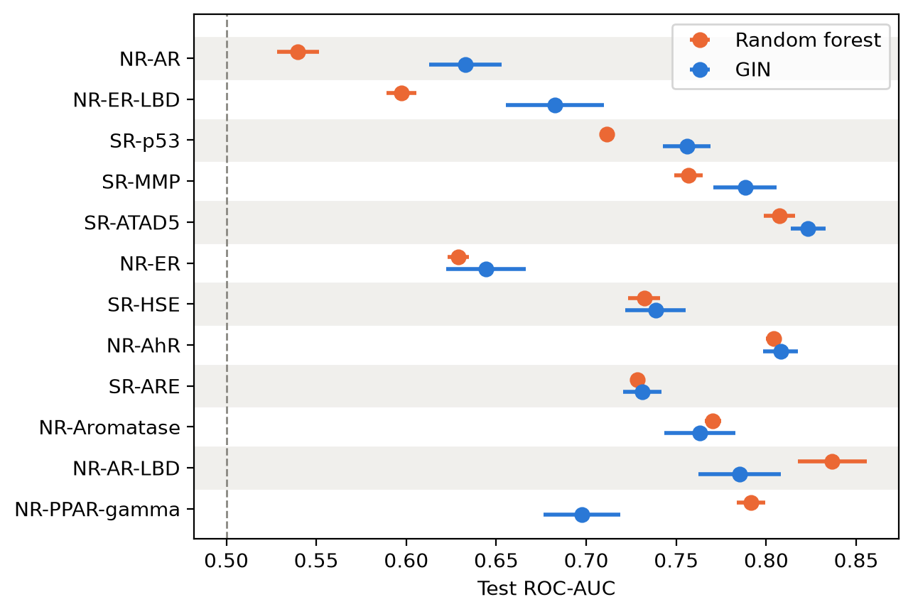

# Molecular Toxicity Deep Learning

Predicting small-molecule toxicity from chemical structure with deep learning, using the [Tox21](https://tox21.gov/) dataset from [MoleculeNet](https://doi.org/10.1039/c7sc02664a).

A learning project and benchmark study. Each model predicts whether a molecule
is active in 12 *in vitro* assays that indicate toxicity pathways (nuclear
receptor signalling and cellular stress responses), a QSAR-style classification
task. A message-passing graph neural network (GIN) and a multi-task MLP on
molecular fingerprints are compared with logistic regression and random forest
baselines, all evaluated on a scaffold split.

Built with [PyTorch](https://pytorch.org/), [RDKit](https://www.rdkit.org/), [scikit-learn](https://scikit-learn.org/), [PyTorch Geometric](https://pytorch-geometric.readthedocs.io/en/latest/) and [Polars](https://pola.rs/).

## Techniques

- **Featurisation**
  - Using [RDKit](https://www.rdkit.org/)
  - [Morgan fingerprints](https://doi.org/10.1021/c160017a018) ([ECFP4](https://doi.org/10.1021/ci100050t)-style)
  - Molecular graphs with one-hot atom features
- **Models**
  - Logistic Regression and Random Forest ([scikit-learn](https://scikit-learn.org/))
  - Multi-Task MLP ([PyTorch](https://pytorch.org/))
  - GIN: Graph Isomorphism Network ([PyTorch Geometric](https://pytorch-geometric.readthedocs.io/en/latest/))
- **Split**
  - [Bemis-Murcko](https://doi.org/10.1021/jm9602928) scaffold split (80/10/10)
  - 7,823 molecules after removing 8 that RDKit cannot parse: 6,258 train, 782 validation, 783 test
  - Test molecules have core structures never seen in training
- **Loss**
  - Masked multi-task binary cross-entropy for the MLP and GIN
  - Missing labels are ignored, never treated as negatives
- **Class Imbalance**
  - Tested class weighting (`class_weight` in scikit-learn, `pos_weight` in PyTorch)
- **Evaluation**
  - ROC-AUC per task, averaged over the 12 tasks
  - Early stopping and all model choices on validation only
  - 5 seeds per model, reported as mean ± std
  - Small GIN hyperparameter grid
- **Additional Tooling**
  - [uv](https://docs.astral.sh/uv/), [pytest](https://docs.pytest.org/en/stable/), [Polars](https://pola.rs/)

## Results

Mean ROC-AUC over the 12 tasks, on the scaffold split:

| Model | Validation AUC | Test AUC |
|---|---|---|
| Logistic Regression | 0.678 | 0.713 |
| Random Forest | 0.735 ± 0.001 | 0.725 ± 0.003 |
| MLP | 0.701 ± 0.002 | 0.692 ± 0.003 |
| GIN | 0.740 ± 0.005 | **0.738 ± 0.006** |

Test ROC-AUC per task for the random forest and GIN models:



- **The GIN model performed best, but only narrowly ahead of the random forest** (0.738 vs 0.725 test AUC), and was higher on 9 of 12 tasks.
- **A learned graph representation seems to beat fixed fingerprints:** the GIN outperformed the MLP (0.738 vs 0.692 test AUC), a similar multi-task network trained on molecular fingerprints.
- **Scores are lower than in the [Tox21 Challenge](https://doi.org/10.3389/fenvs.2015.00085).** Challenge entries used a wide range of chemical descriptors, fingerprints and machine learning algorithms. The scaffold split used here means every test molecule has a core structure not seen in training, which makes the task harder.

## Usage

```bash
git clone https://github.com/jamesmeadows7/Molecular-Toxicity-Deep-Learning.git
cd Molecular-Toxicity-Deep-Learning
uv sync

# rebuild results tables and figures from saved metrics
uv run python scripts/analysis.py

# retrain models
uv run python scripts/logistic_regression.py
uv run python scripts/random_forest.py
uv run python -m tox21.train --config configs/mlp.yaml
uv run python -m tox21.train --config configs/gnn.yaml

# run tests
uv run pytest
```

## Layout

```
configs/        YAML settings for the MLP and GIN
scripts/        EDA, LR and RF baselines, GIN tuning grid, results analysis
src/tox21/      data loading, featurisation, scaffold split, models, loss, training
tests/          pytest tests
results/        per-run metrics, summary tables and figures
```